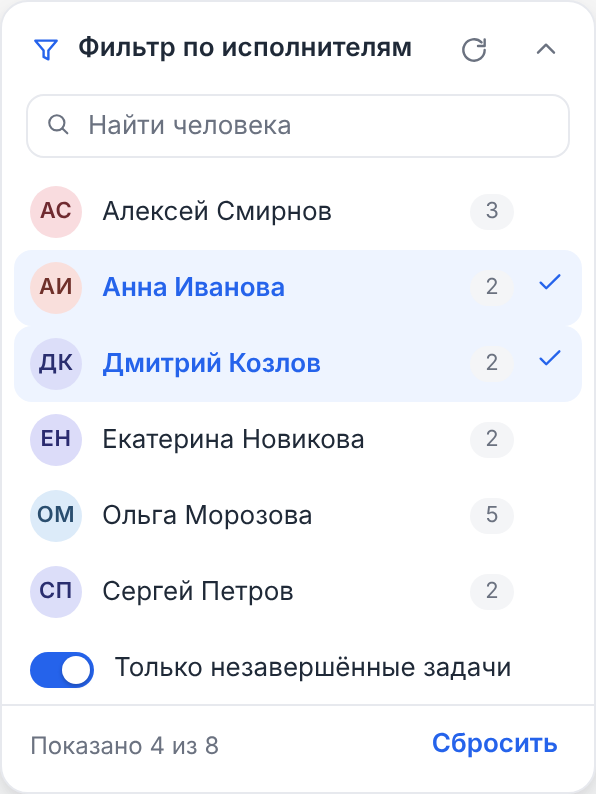
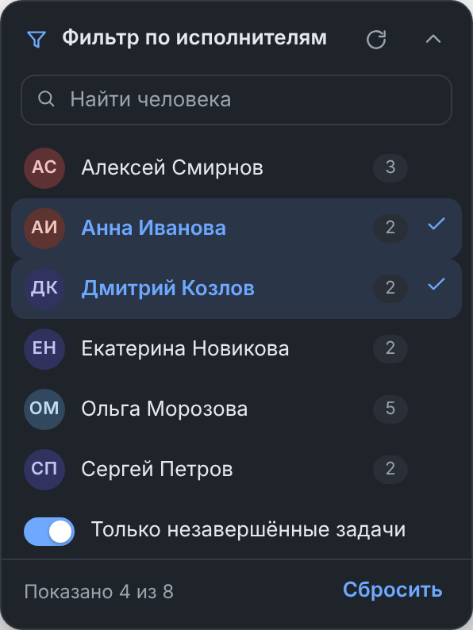

# ADO Board Task Filter

Расширение для Chrome и Edge. На канбан-доске Azure DevOps Server оставляет только карточки, в которых участвуют выбранные люди: человек назначен на саму карточку, указан в другом поле-ответственном или исполняет её дочернюю задачу.

<p>
  
  
</p>

## Какую задачу решает

Встроенный фильтр доски по Assigned To смотрит только на поля самой карточки. Если PBI назначают на владельца продукта или аналитика, а разработчики работают в дочерних Task, встроенным фильтром нельзя показать, чем сейчас занят конкретный разработчик. Приходится открывать карточки по одной.

Расширение собирает участников со всех карточек доски и их дочерних задач. Выбираете людей в панели, и на доске остаются карточки с их участием. Колонки, дорожки, перетаскивание и встроенные фильтры работают как раньше.

## Возможности

- Работает с любым сервером Azure DevOps Server 2020 и новее: адрес добавляется на странице настроек, доступ браузер выдаёт отдельно на каждый сервер.
- Список людей с числом карточек каждого и поиск по имени.
- Выбор нескольких людей: остаются карточки любого из них.
- Учитываются Assigned To, пользовательские и многозначные поля типа Identity и исполнители дочерних элементов.
- Переключатель «Только незавершённые задачи» скрывает завершённую работу.
- Новые карточки на доске дозагружаются сами, данные обновляются кнопкой или по расписанию.
- Сброс не трогает карточки, скрытые встроенным фильтром доски.
- Выбор запоминается для каждой доски.
- Панель сворачивается в компактную кнопку, есть светлая и тёмная тема, управление с клавиатуры.
- Настраиваются типы дочерних элементов, завершённые состояния, поля-исключения, сторона панели, версия API и селекторы карточек.

## Установка

1. Скачайте репозиторий и положите папку `extension` туда, где она будет храниться постоянно.
2. Откройте `chrome://extensions` (или `edge://extensions`), включите режим разработчика и нажмите «Загрузить распакованное расширение».
3. Выберите папку `extension`. Откроется страница настроек.
4. Добавьте адрес своего сервера и разрешите доступ.
5. Откройте канбан-доску. Панель появится в правом нижнем углу.

Подробнее: [Установка и настройка](docs/install.md).

## Документация

| Документ | Для кого |
|---|---|
| [Руководство оператора](docs/user-guide.md) (по ГОСТ 19.505-79) | участник команды, ведущий встреч |
| [Установка и настройка](docs/install.md) | пользователь, администратор |
| [Аналитика решения](docs/analysis/index.md): требования, BPMN, архитектура, интеграция с REST API, модель данных, поведение, проверка | аналитик, разработчик |

Документация собирается в сайт: `pip install mkdocs-material`, затем `mkdocs serve`.

## Безопасность

- При установке расширение не получает доступа ни к одному сайту. Доступ выдаётся на сервер, который вы добавили сами.
- Расширение только читает рабочие элементы и ничего не меняет на сервере.
- Запросы идут от имени вашей сессии в браузере. Пароли и токены не запрашиваются и не хранятся.
- Данные рабочих элементов не сохраняются и не покидают браузер и сервер. В браузере хранятся только настройки и выбранные люди.

## Проверка

```
npm install
npx playwright install chromium
npm test
```

48 автоматических проверок: логика на имитации доски и REST API, страница настроек, загрузка расширения в Chromium. Результаты и матрица трассировки — в [документе о проверке](docs/analysis/testing.md).

## Структура

```
extension/           расширение (Manifest V3)
  src/background.js  регистрация скрипта для разрешённых серверов
  src/shared/        настройки
  src/content/       клиент API, модель данных, работа с доской, панель, контроллер
  src/options/       страница настроек
docs/                документация в Markdown
docs/analysis/       требования, архитектура, интеграция, модель данных, проверка
docs/bpmn/           исходники BPMN (bpmn.io, Camunda Modeler)
tests/               автоматические проверки и скрипт скриншотов
mkdocs.yml           сайт документации
```

## Ограничения

- Карточки находятся по CSS-селекторам доски. Если после обновления сервера расширение перестанет их находить, селекторы меняются в настройках.
- Учитываются только прямые дочерние элементы карточки.
- Доска задач спринта и облачная Azure DevOps Services не поддерживаются.
