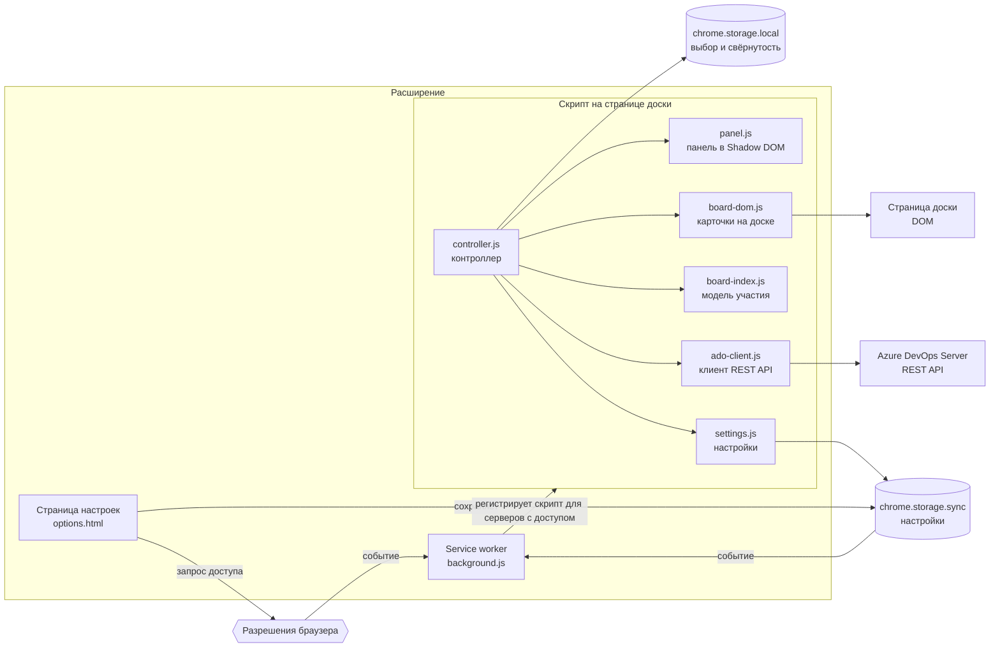
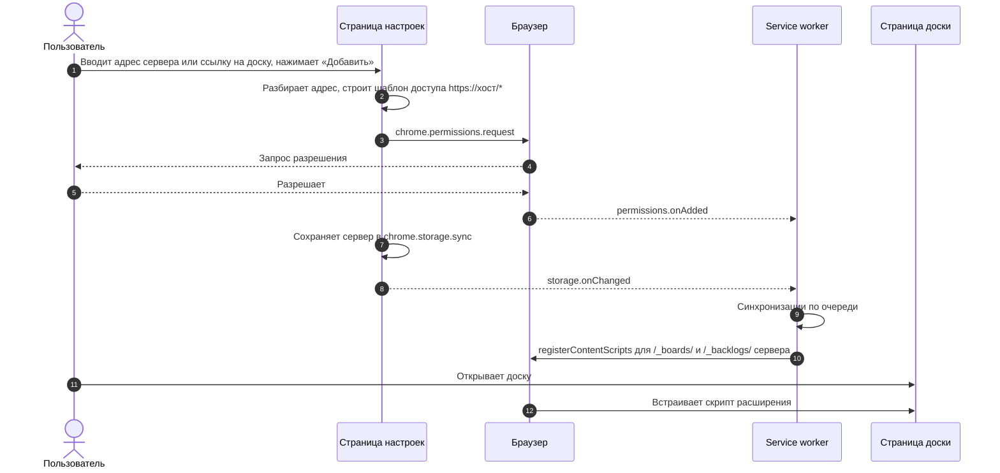

# Архитектура

Расширение для Chromium на Manifest V3. Доступ к сайтам при установке не запрашивается: пользователь добавляет сервер на странице настроек, браузер спрашивает разрешение на этот сервер, и только после этого скрипт расширения начинает встраиваться в его доски.

## Компоненты

| Модуль | Ответственность |
|---|---|
| `src/shared/settings.js` | Значения по умолчанию, проверка и нормализация настроек, разбор адреса сервера, шаблоны адресов для браузера |
| `src/background.js` | Регистрирует скрипт на страницах досок серверов с выданным доступом. Синхронизации выполняются по очереди. Кнопка расширения открывает настройки |
| `src/content/ado-client.js` | Запросы к REST API: пакеты, тайм-аут, понятные ошибки, базовый адрес и ключ доски |
| `src/content/board-index.js` | Модель «кто участвует в карточке», список людей с числом карточек, решение по карточке |
| `src/content/board-dom.js` | Поиск карточек и их номеров, скрытие с отметкой расширения, наблюдение за появлением и исчезновением карточек |
| `src/content/panel.js` | Панель в Shadow DOM: поиск, список с мультивыбором, переключатель, свёрнутое состояние, темы, клавиатура |
| `src/content/controller.js` | Загрузка и дозагрузка данных, применение отбора, смена доски, автообновление, реакция на изменение настроек |
| `src/options/*` | Страница настроек |

## Подключение сервера

## Решения

| Решение | Почему |
|---|---|
| Доступ к серверам по запросу (`optional_host_permissions`) вместо списка адресов в манифесте | Расширение подходит любому серверу без правки кода и не получает доступ к сайтам, которые пользователь не добавил |
| Динамическая регистрация скрипта (`chrome.scripting.registerContentScripts`) | Список страниц для встраивания меняется вместе с настройками, без переустановки расширения |
| Очередь синхронизаций в service worker | Выдача доступа и сохранение настроек приходят почти одновременно; без очереди скрипт регистрировался бы дважды |
| Панель в Shadow DOM, хост панели в `<html>` | Стили изолированы от доски, а изменения панели не видит наблюдатель за доской, поэтому нет повторных пересчётов |
| Скрытие классом встроенного фильтра плюс собственная отметка | Доска сама пересчитывает высоту дорожек, а сброс трогает только то, что скрыло расширение |
| Пересчёт раскладки только при изменении набора скрытых карточек | Перерисовка доски не вызывает лишних событий `resize` |
| Номер загрузки и отбрасывание устаревших ответов | Быстрые повторные загрузки и смена доски не смешивают данные |
| WIQL-запросы по 100 карточек | Длина запроса не растёт вместе с доской |
