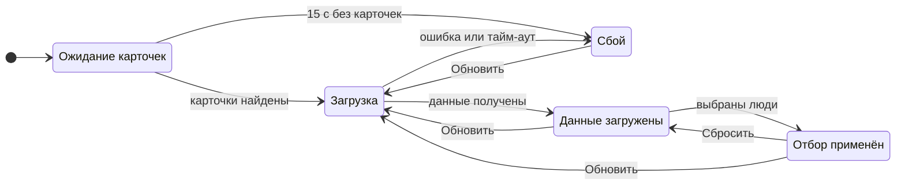
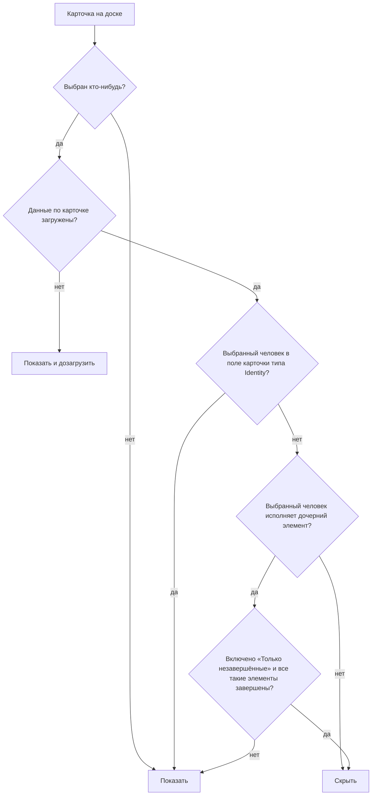

# Поведение панели

## Состояния

Если при загрузке есть сохранённый выбор для доски, панель сразу переходит в состояние «Отбор применён». Смена выбора, переключателя и перерисовка доски оставляют панель в том же состоянии. Новые карточки дозагружаются в фоне, в строке состояния к счётчику добавляется «· загружаю новые».

Переход на другую доску возвращает панель в состояние «Ожидание карточек». На страницах, где нет доски, панель скрыта.

Свёрнутость — независимое состояние. Оно не влияет на отбор и запоминается между досками.

| Состояние | Строка состояния |
|---|---|
| Ожидание карточек | Жду карточки на доске… |
| Загрузка | Загружаю данные по N карточкам… |
| Сбой | Карточки не найдены… или текст ошибки из раздела [Интеграция](integration.md) |
| Данные загружены | Карточек на доске: N. Выберите людей |
| Отбор применён | Показано N из M |

## Решение по карточке

«Скрыть» ставит класс встроенного фильтра доски и отметку расширения, только если карточка ещё не скрыта. «Показать» снимает класс, только если на карточке есть отметка расширения. Карточки, скрытые встроенным фильтром, не попадают в счётчики «Показано N из M».

## Управление с клавиатуры

| Клавиша | Где | Действие |
|---|---|---|
| ↓ | Поле поиска | Перейти к списку людей |
| ↑ / ↓ | Список людей | Перейти к соседней строке |
| Пробел, Enter | Строка списка | Выбрать человека или снять выбор |
| Esc | Поле поиска | Очистить поиск |
| Tab | Панель | Переход между кнопками, полем поиска, списком и переключателем |
