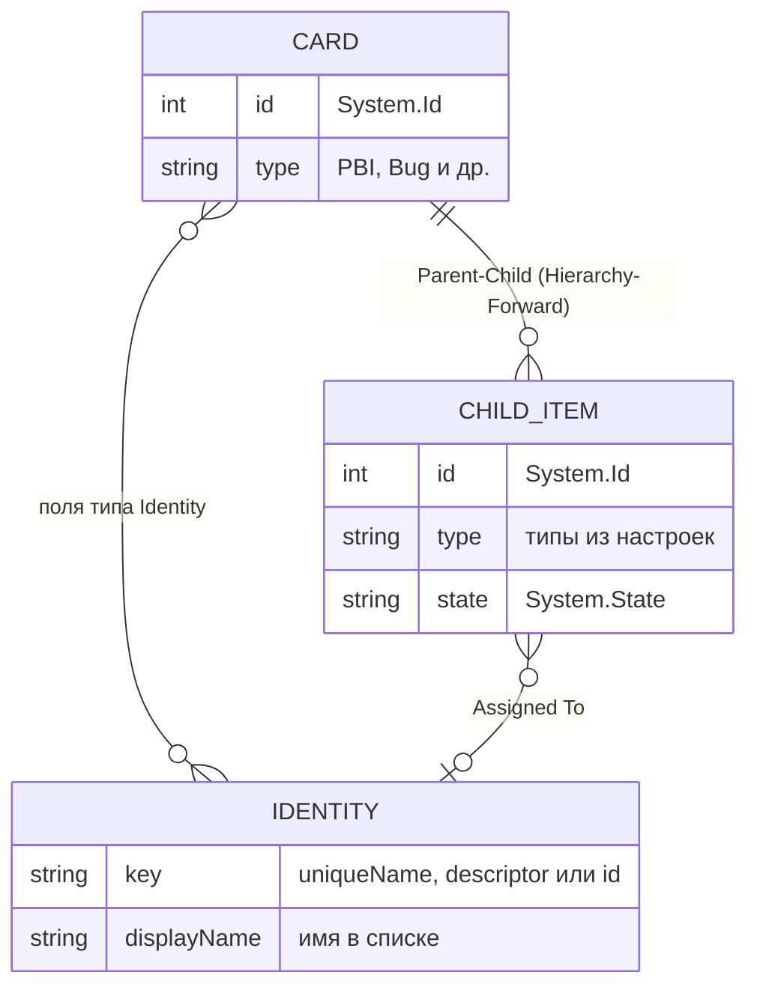

# Модель данных

## Сущности Azure DevOps

Карточка (CARD) — рабочий элемент на канбан-доске. Дочерний элемент (CHILD_ITEM) — прямой потомок карточки одного из типов из настроек, по умолчанию Task. Identity — человек, указанный в поле с типом Identity.

## Используемые поля

| Поле | Где читается | Зачем |
|---|---|---|
| `System.Id` | Карточка, дочерний элемент | Связать ответы сервера с карточками на доске |
| Все поля типа Identity, кроме исключённых | Карточка | Определить участников карточки |
| `System.AssignedTo` | Дочерний элемент | Определить исполнителя |
| `System.State` | Дочерний элемент | Отличить незавершённый элемент от завершённого |
| `System.WorkItemType` | Условие WIQL | Ограничить дочерние элементы типами из настроек |

## Правила определения участия

| ID | Правило |
|---|---|
| П-1 | Значение поля — участник, если это объект со строковым `displayName` и непустым строковым `uniqueName`, `descriptor` или `id`. Многозначные поля разбираются поэлементно |
| П-2 | Ключ участника — `uniqueName`, при его отсутствии `descriptor`, затем `id`, в нижнем регистре. В списке показывается `displayName` |
| П-3 | Поля из списка исключений не считаются участием. По умолчанию это поля истории: `System.CreatedBy`, `System.ChangedBy`, `System.AuthorizedAs`, `Microsoft.VSTS.Common.ActivatedBy`, `Microsoft.VSTS.Common.ResolvedBy`, `Microsoft.VSTS.Common.ClosedBy` |
| П-4 | Дочерний элемент завершён, если его состояние есть в списке завершённых состояний. Сравнение без учёта регистра |
| П-5 | Дочерний элемент без исполнителя не добавляет участника |
| П-6 | Переключатель «Только незавершённые задачи» влияет только на дочерние элементы. Участие через поля карточки учитывается всегда |
| П-7 | Карточка подходит под выбор, если среди её участников есть хотя бы один выбранный человек |
| П-8 | Карточка, по которой сервер не вернул данных (удалена или нет доступа), считается карточкой без участников |

## Настройки

Хранятся в `chrome.storage.sync` и синхронизируются с профилем браузера.

| Ключ | По умолчанию | Назначение |
|---|---|---|
| `servers` | `[]` | Серверы, на которых работает расширение (origin) |
| `childTypes` | `["Task"]` | Типы дочерних элементов |
| `doneStates` | `["Closed", "Done", "Removed", "Resolved"]` | Завершённые состояния |
| `useCardFields` | `true` | Учитывать людей из полей карточки |
| `ignoredFields` | шесть полей истории (П-3) | Поля, которые не считаются участием |
| `onlyActiveByDefault` | `true` | Положение переключателя при открытии доски |
| `rememberSelection` | `true` | Запоминать выбор для каждой доски |
| `autoRefreshMinutes` | `0` | Автообновление: 0, 1, 5, 15 или 30 минут |
| `panelSide` | `right` | Сторона экрана для панели |
| `theme` | `auto` | Тема панели: `auto`, `light`, `dark` |
| `apiVersion` | `6.0` | Версия REST API. Неверное значение заменяется на `6.0` |
| `cardSelector` | `.board-tile` | Селектор карточки |
| `cardIdSelector` | `.id-title-container .id` | Селектор номера внутри карточки |

## Локальное состояние

Хранится в `chrome.storage.local`, только в этом браузере.

| Ключ | Содержимое |
|---|---|
| `selection:{адрес доски}` | Выбранные люди (ключи участников) и положение переключателя для доски |
| `collapsed` | Свёрнута ли панель |

Данные рабочих элементов живут в памяти вкладки, пока открыта доска, и никуда не сохраняются.

## Модель в памяти

| Структура | Ключ | Содержимое |
|---|---|---|
| `cards` | номер карточки | ключи участников из полей карточки, номера дочерних элементов |
| `children` | номер дочернего элемента | состояние, ключ исполнителя |
| `names` | ключ участника | отображаемое имя |
