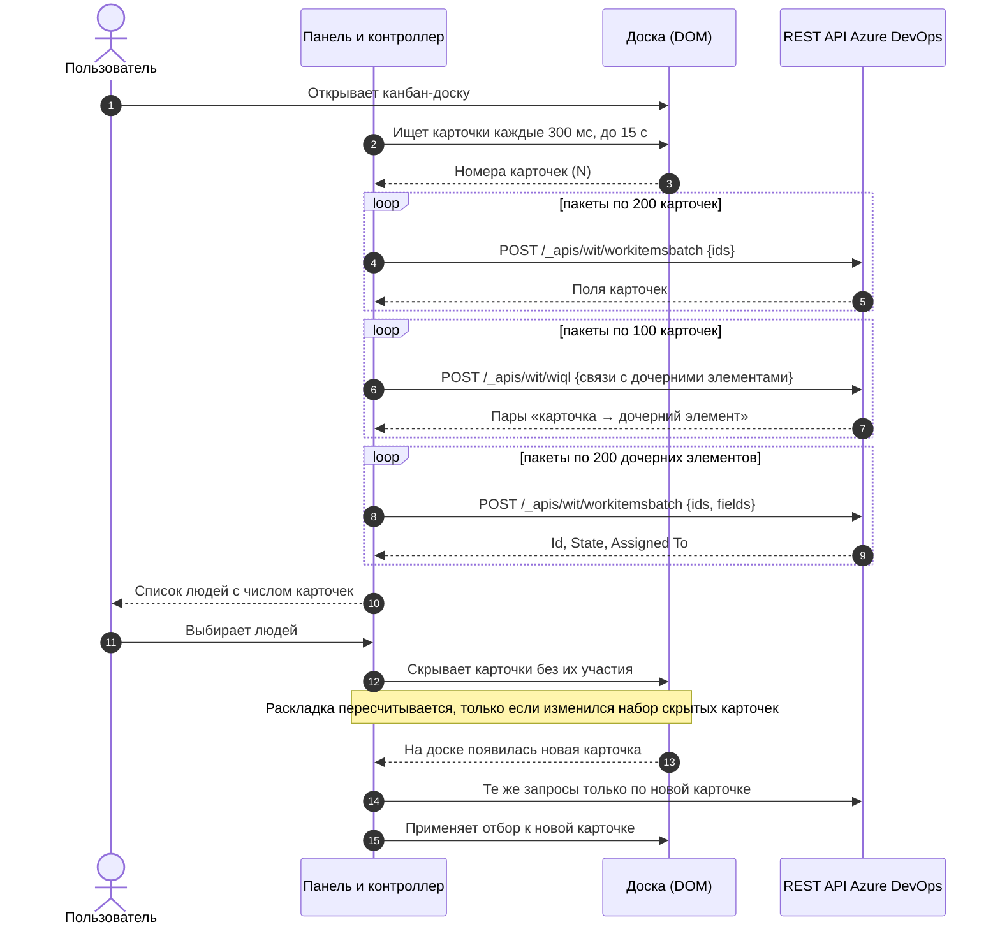

# Интеграция с REST API Azure DevOps Server

## Общие сведения

| Параметр | Значение |
|---|---|
| Протокол | HTTPS или HTTP, как у сервера |
| Формат | JSON |
| Версия API | Из настроек, по умолчанию `6.0` |
| Методы | `POST` для всех запросов. Запросы только читают данные |
| Аутентификация | Cookie текущей сессии пользователя (`credentials: 'include'`) |
| Тайм-аут | 20 секунд на запрос |
| Базовый адрес | Часть адреса страницы до сегмента `_boards` или `_backlogs` |

| Адрес страницы доски | Базовый адрес API |
|---|---|
| `https://ado.example.com/tfs/Coll/Proj/_boards/board/t/Team/Stories` | `https://ado.example.com/tfs/Coll/Proj` |
| `https://ado.example.com/Coll/Proj/_boards/board/t/Team/Stories` | `https://ado.example.com/Coll/Proj` |

## Последовательность обмена



## Запрос 1. Поля карточек

```
POST {base}/_apis/wit/workitemsbatch?api-version=6.0
```

Тело запроса. Параметр `fields` не передаётся, сервер возвращает все поля, в том числе пользовательские:

```json
{ "ids": [101, 102, 103, 104] }
```

Если в настройках выключено «Людей из полей карточки», запрашивается только номер: `"fields": ["System.Id"]`.

Ответ (сокращён):

```json
{
  "count": 4,
  "value": [
    {
      "id": 102,
      "fields": {
        "System.Id": 102,
        "System.WorkItemType": "Product Backlog Item",
        "System.AssignedTo": { "displayName": "Dev B", "uniqueName": "dev.b@corp", "id": "…" },
        "Custom.Responsible": { "displayName": "Analyst D", "uniqueName": "analyst.d@corp", "id": "…" },
        "Custom.Reviewers": [ { "displayName": "QA E", "uniqueName": "qa.e@corp", "id": "…" } ]
      }
    }
  ]
}
```

Расширение не знает имён пользовательских полей заранее. Оно перебирает все поля и отбирает значения типа Identity по правилам из раздела [Модель данных](data-model.md).

## Запрос 2. Связи с дочерними элементами

```
POST {base}/_apis/wit/wiql?api-version=6.0
```

Тело запроса. Типы дочерних элементов берутся из настроек, номера карточек передаются частями по 100:

```json
{
  "query": "SELECT [System.Id] FROM WorkItemLinks WHERE [Source].[System.Id] IN (101, 102, 103, 104) AND [System.Links.LinkType] = 'System.LinkTypes.Hierarchy-Forward' AND [Target].[System.WorkItemType] IN ('Task') MODE (MustContain)"
}
```

Ответ (сокращён):

```json
{
  "queryType": "oneHop",
  "workItemRelations": [
    { "rel": null, "source": null, "target": { "id": 101 } },
    { "rel": "System.LinkTypes.Hierarchy-Forward", "source": { "id": 101 }, "target": { "id": 201 } },
    { "rel": "System.LinkTypes.Hierarchy-Forward", "source": { "id": 101 }, "target": { "id": 202 } }
  ]
}
```

Учитываются только записи со связью `Hierarchy-Forward`, где заполнены `source` и `target`. Если в настройках не указан ни один тип дочерних элементов, запрос не выполняется. Апострофы в названиях типов экранируются удвоением.

## Запрос 3. Поля дочерних элементов

```
POST {base}/_apis/wit/workitemsbatch?api-version=6.0
```

```json
{
  "ids": [201, 202, 203, 204],
  "fields": ["System.Id", "System.State", "System.AssignedTo"]
}
```

Если у элемента не заполнено Assigned To, поле в ответе отсутствует. Такой элемент не добавляет участника.

## Количество запросов

Для доски из N карточек с T дочерними элементами: ⌈N/200⌉ + ⌈N/100⌉ + ⌈T/200⌉ запросов. Доска из 60 карточек со 150 Task загружается за 3 запроса, доска из 250 карточек без дочерних элементов — за 5. Смена выбора и переключателя запросов не выполняет. Новая карточка на доске стоит 2–3 запроса только по ней.

## Обработка ошибок

| Ситуация | Сообщение в панели |
|---|---|
| HTTP 401 | Сервер не принял вход. Войдите в Azure DevOps в этом браузере. |
| HTTP 403 | Нет прав на чтение рабочих элементов проекта. |
| HTTP 404 | Сервер не нашёл проект. Проверьте адрес доски. |
| HTTP 5xx | Ошибка на сервере (HTTP код). Повторите позже. |
| Другой код | Сервер ответил HTTP код и текст статуса |
| Нет ответа 20 с | Сервер не ответил за 20 секунд. |
| Сетевая ошибка | Сервер недоступен. Проверьте сеть или VPN. |
| Ошибка дозагрузки новых карточек | Не удалось загрузить новые карточки. Нажмите «Обновить». |

Тело ответа с ошибкой (первые 500 символов) пишется в консоль браузера с префиксом `[ADO Board Task Filter]`. Автоматических повторов нет: пользователь повторяет загрузку кнопкой обновления.

## Устаревшие ответы

Каждая полная загрузка получает номер. Если пользователь нажал обновление или перешёл на другую доску, ответы предыдущей загрузки отбрасываются и не попадают в отбор.
