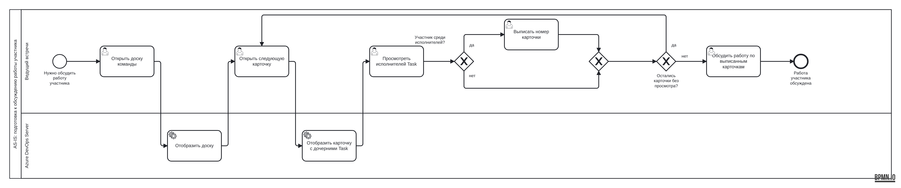
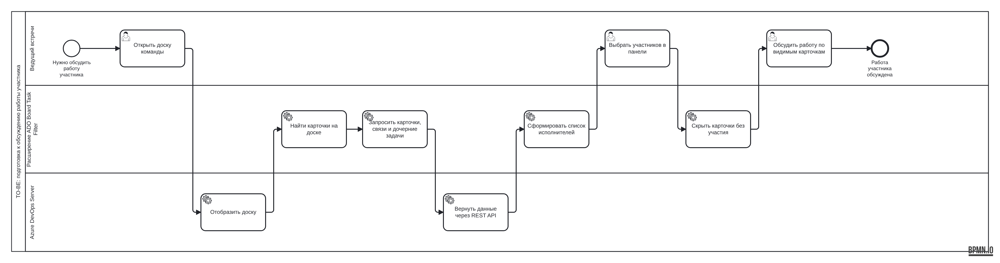

# Процессы AS-IS и TO-BE

Процесс: ведущий встречи готовится обсудить работу участника команды на ежедневной встрече, перед планированием или на встрече один на один. Диаграммы выполнены в нотации BPMN 2.0. Исходники лежат в `docs/bpmn/` и открываются в [bpmn.io](https://demo.bpmn.io) или Camunda Modeler.

## AS-IS: без расширения

Ведущий открывает доску и по очереди открывает карточки. В каждой он просматривает дочерние задачи и их исполнителей и выписывает номера карточек, где есть задачи нужного участника. Цикл повторяется для каждой карточки на доске.

Узкие места:

- число действий растёт вместе с числом карточек: каждую нужно открыть и просмотреть;
- результат зависит от внимательности ведущего, карточку легко пропустить;
- промежуточный список живёт вне доски, в заметках или в голове;
- участники встречи ждут, пока ведущий соберёт список.

## TO-BE: с расширением

Ведущий открывает доску и выбирает участников в панели. Поиск карточек, запросы к серверу и отбор выполняет расширение. Цикл по карточкам уходит из работы человека, и число его действий больше не зависит от размера доски.

## Что изменилось

| Аспект | AS-IS | TO-BE |
|---|---|---|
| Действия ведущего | Открыть и просмотреть каждую карточку | Открыть доску и выбрать участников |
| Зависимость от размера доски | Растёт с числом карточек | Нет |
| Риск пропустить карточку | Есть | Отбор идёт по данным сервера |
| Где результат | Список вне доски | Сама доска: на ней остаются нужные карточки |
| Права и настройка сервера | Не нужны | Не нужны: расширение читает данные с правами пользователя |
