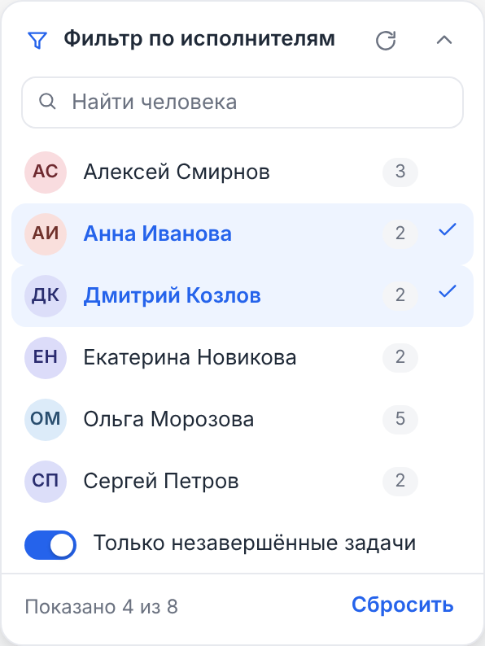

# ADO Board Task Filter

Расширение для Chrome и Edge. На канбан-доске Azure DevOps Server оставляет только карточки, в которых участвуют выбранные люди: человек назначен на саму карточку, указан в другом поле-ответственном или исполняет её дочернюю задачу.

{ width="300" }

Встроенный фильтр доски по Assigned To смотрит только на поля самой карточки. Если разработчики работают в дочерних Task, по нему нельзя показать, чем занят конкретный человек. Расширение собирает участников со всех карточек и их дочерних задач и после выбора людей скрывает карточки без их участия.

| Документ | Для кого |
|---|---|
| [Руководство оператора](user-guide.md) (ГОСТ 19.505-79) | участник команды, ведущий встреч |
| [Установка и настройка](install.md) | пользователь, администратор |
| [Аналитика решения](analysis/index.md) | аналитик, разработчик |

Версия: 1.0.0.
