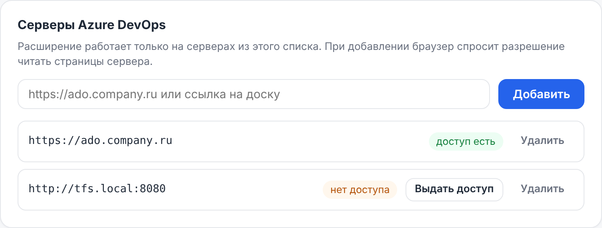
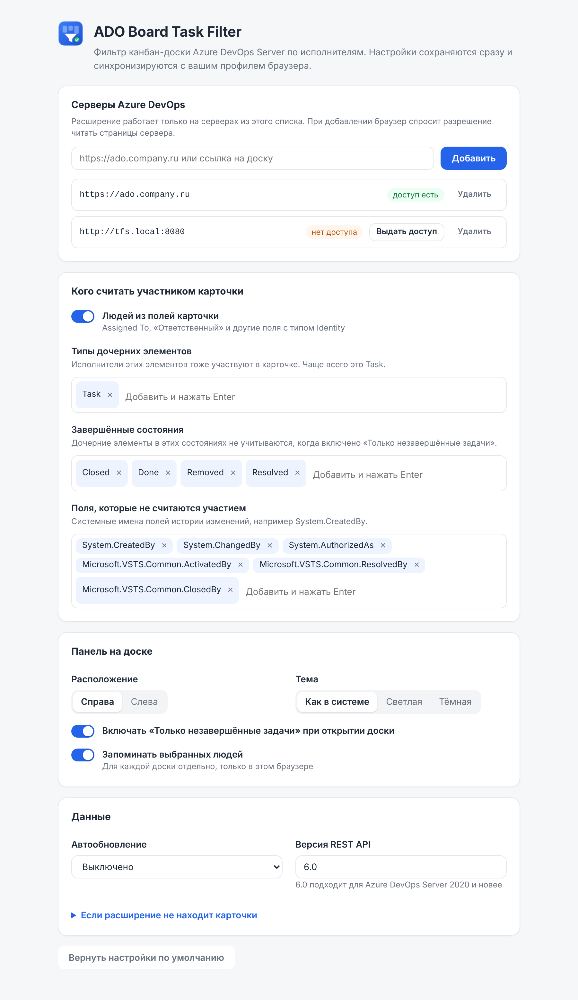

# Установка и настройка

## Что понадобится

- Браузер на Chromium версии 102 или новее: Google Chrome или Microsoft Edge.
- Адрес сервера Azure DevOps Server 2020 или новее, например `https://ado.company.ru`.
- Право устанавливать расширения. Если браузером управляют групповые политики, установку распакованных расширений может запрещать администратор.
- Папка `extension` из этого репозитория.

## Установка

1. Положите папку `extension` туда, где она будет храниться постоянно. Браузер загружает расширение прямо из этой папки.
2. Откройте `chrome://extensions` в Chrome или `edge://extensions` в Edge.
3. Включите «Режим разработчика».
4. Нажмите «Загрузить распакованное расширение» и выберите папку `extension`, в которой лежит `manifest.json`.
5. Откроется страница настроек расширения. Позже её можно открыть кнопкой расширения на панели браузера.

Расширение не просит доступ к сайтам при установке. Доступ к каждому серверу выдаётся отдельно, когда вы добавляете его в настройках.

## Подключение сервера

1. На странице настроек в разделе «Серверы Azure DevOps» введите адрес сервера. Подойдёт и голый адрес `ado.company.ru`, и ссылка на доску целиком: расширение само выделит сервер.
2. Нажмите «Добавить». Браузер спросит разрешение читать страницы этого сервера. Разрешите.
3. Сервер появится в списке с пометкой «доступ есть».
4. Откройте канбан-доску на этом сервере. В правом нижнем углу появится панель «Фильтр по исполнителям».

Если в доступе отказать, сервер останется в списке с пометкой «нет доступа». Расширение не будет работать на его страницах, пока вы не нажмёте «Выдать доступ». Кнопка «Удалить» убирает сервер из списка и отзывает доступ.

> Браузер выдаёт доступ на имя хоста целиком, без учёта порта. Сервер `http://tfs.local:8080` получит доступ ко всем страницам `http://tfs.local`.

## Настройки

Все изменения сохраняются сразу, рядом с кнопкой сброса появляется отметка «Сохранено». Открытые доски подхватывают новые настройки без перезагрузки страницы. Настройки синхронизируются с профилем браузера.

### Кого считать участником карточки

| Настройка | По умолчанию | Что меняет |
|---|---|---|
| Людей из полей карточки | включено | Учитывать Assigned To, «Ответственный» и другие поля карточки с типом Identity. Если выключить, участниками будут только исполнители дочерних элементов |
| Типы дочерних элементов | Task | Исполнители дочерних элементов этих типов участвуют в карточке. Добавьте Bug, если баги заводятся дочерними элементами PBI |
| Завершённые состояния | Closed, Done, Removed, Resolved | Элементы в этих состояниях не учитываются при включённом «Только незавершённые задачи». Добавьте свои, например «Выполнено». Регистр букв не важен |
| Поля, которые не считаются участием | шесть полей истории изменений | Системные имена полей типа Identity, которые не означают участия, например `System.CreatedBy` |

Значение в список добавляется клавишей Enter или запятой, удаляется крестиком или клавишей Backspace в пустом поле.

### Панель на доске

| Настройка | По умолчанию | Что меняет |
|---|---|---|
| Расположение | Справа | Угол экрана для панели |
| Тема | Как в системе | Светлая, тёмная или по настройке операционной системы |
| Включать «Только незавершённые задачи» при открытии доски | включено | Положение переключателя на новой доске |
| Запоминать выбранных людей | включено | Выбор хранится для каждой доски отдельно, только в этом браузере |

### Данные

| Настройка | По умолчанию | Что меняет |
|---|---|---|
| Автообновление | Выключено | Перезагрузка данных каждые 1, 5, 15 или 30 минут, пока вкладка с доской на экране |
| Версия REST API | 6.0 | Версия API в запросах к серверу. Неверное значение заменяется на 6.0 |
| Селектор карточки | `.board-tile` | CSS-селектор карточки на доске. Меняйте, только если расширение не находит карточки |
| Селектор номера внутри карточки | `.id-title-container .id` | CSS-селектор номера. Если номер не найден, расширение ищет ссылку на рабочий элемент внутри карточки |

Кнопка «Вернуть настройки по умолчанию» сбрасывает всё, кроме списка серверов.

## Проверка работы

1. Откройте канбан-доску на добавленном сервере.
2. Панель появится сразу с сообщением «Жду карточки на доске…», затем «Загружаю данные по N карточкам…».
3. После загрузки в строке состояния будет «Карточек на доске: N. Выберите людей», а в списке — люди с числом карточек.
4. Выберите человека. На доске останутся карточки с его участием, в строке состояния — «Показано N из M».

Если что-то пошло не так, смотрите раздел 4 «Сообщения оператору» в [руководстве оператора](user-guide.md). Технические сообщения расширение пишет в консоль браузера (F12 → Console) с префиксом `[ADO Board Task Filter]`.

## Обновление и удаление

Чтобы обновить расширение, замените файлы в папке и нажмите кнопку перезагрузки на карточке расширения в `chrome://extensions`. Настройки сохранятся.

Чтобы удалить расширение, нажмите «Удалить» на его карточке. Вместе с расширением браузер удалит его настройки и выданный доступ.
