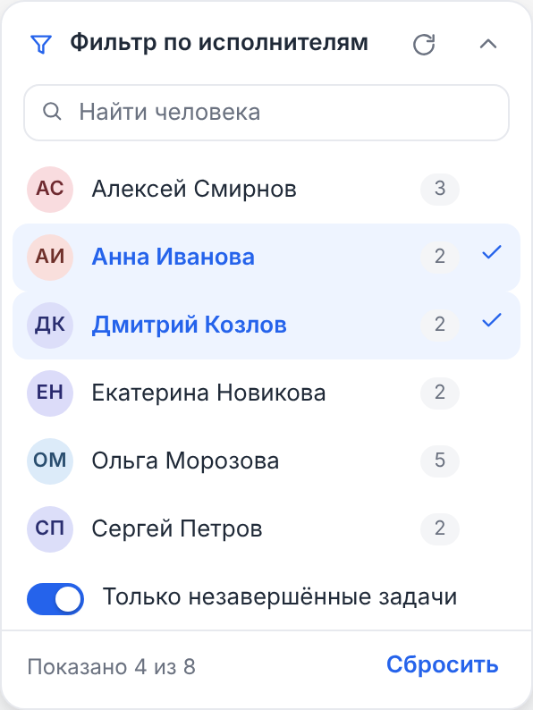

# Руководство оператора

**ADO Board Task Filter. Фильтр канбан-доски Azure DevOps по исполнителям**

Обозначение документа: RU.00000000.00001-01 34 01

Версия программы: 1.0.0

*Обозначение составлено по ГОСТ 19.103-77, код организации-разработчика условный. Код вида документа 34 — «Руководство оператора» по ГОСТ 19.101-77.*

---

## Аннотация

Документ содержит сведения о назначении программы ADO Board Task Filter версии 1.0.0, об условиях её выполнения, о порядке работы оператора и о сообщениях, которые программа выдаёт оператору.

Документ составлен в соответствии с ГОСТ 19.505-79 «ЕСПД. Руководство оператора. Требования к содержанию и оформлению».

Оператором в документе называется пользователь канбан-доски Azure DevOps Server: участник команды разработки, ведущий командной встречи или руководитель.

## Содержание

1. Назначение программы
2. Условия выполнения программы
3. Выполнение программы
4. Сообщения оператору

---

## 1. Назначение программы

### 1.1. Функциональное назначение

Программа оставляет на канбан-доске Azure DevOps Server карточки рабочих элементов, в которых участвует хотя бы один из выбранных оператором людей, и скрывает остальные карточки.

Человек участвует в карточке, если выполняется хотя бы одно из условий:

а) человек указан в поле карточки с типом Identity: Assigned To, пользовательском поле вида «Ответственный» или другом поле того же типа, в том числе многозначном;

б) человек исполняет прямой дочерний элемент карточки одного из типов, заданных в настройках (по умолчанию Task).

Поля истории изменений участием не считаются: Created By, Changed By, Authorized As, Activated By, Resolved By, Closed By. Перечень можно изменить в настройках.

### 1.2. Эксплуатационное назначение

Программа применяется:

- при проведении ежедневной встречи команды по участникам;
- при обсуждении текущей работы и загрузки одного или нескольких участников;
- при просмотре участником собственных задач на общей доске.

Программа только читает данные с сервера. Рабочие элементы она не создаёт, не изменяет и не удаляет.

### 1.3. Состав функций

Таблица 1 — Функции программы

| Обозначение | Функция |
|---|---|
| Ф1 | Формирование списка людей на доске с числом карточек каждого |
| Ф2 | Поиск человека в списке |
| Ф3 | Отбор карточек по одному или нескольким людям |
| Ф4 | Учёт только незавершённых дочерних элементов |
| Ф5 | Обновление данных вручную и по расписанию |
| Ф6 | Дозагрузка карточек, появившихся на доске |
| Ф7 | Сброс отбора |
| Ф8 | Запоминание выбора для каждой доски |
| Ф9 | Сворачивание панели |
| Ф10 | Вывод сообщений о ходе работы и ошибках |

## 2. Условия выполнения программы

### 2.1. Технические средства

Персональный компьютер, на котором работает браузер из п. 2.2, и сетевой доступ к серверу Azure DevOps Server. Дополнительных требований к техническим средствам программа не предъявляет.

### 2.2. Программные средства

Для выполнения программы необходимы:

- браузер на основе Chromium версии 102 или новее (Google Chrome, Microsoft Edge) с установленной программой;
- сервер Azure DevOps Server 2020 или новее с REST API версии 6.0;
- сервер добавлен в настройках программы, и доступ к нему разрешён (документ «Установка и настройка»).

### 2.3. Требования к оператору

Оператор должен:

- иметь учётную запись на сервере Azure DevOps Server с правом чтения рабочих элементов проекта и выполнить вход в этом браузере;
- владеть навыками работы с канбан-доской Azure DevOps.

## 3. Выполнение программы

### 3.1. Запуск программы

Программа запускается автоматически при открытии страницы канбан-доски на разрешённом сервере.

1. Откройте канбан-доску команды.
2. В правом нижнем углу окна появится панель «Фильтр по исполнителям» (рисунок 1) с сообщением «Жду карточки на доске…».
3. Когда доска отрисует карточки, программа загрузит с сервера их поля, связи и дочерние элементы. В строке состояния выводится «Загружаю данные по N карточкам…».
4. После загрузки в панели появится список людей, а в строке состояния — «Карточек на доске: N. Выберите людей».

Если для доски сохранён выбор, программа восстановит его и сразу применит отбор.

Рисунок 1 — Панель «Фильтр по исполнителям»

Таблица 2 — Элементы панели

| Элемент | Назначение |
|---|---|
| Кнопка обновления (круговая стрелка) | Повторная загрузка данных с сервера. Во время загрузки вращается |
| Кнопка сворачивания (стрелка вверх) | Сворачивание панели в компактную кнопку |
| Поле «Найти человека» | Поиск по части имени |
| Список людей | Имя, инициалы и число карточек на доске. Выбранные люди подсвечены и отмечены галочкой |
| Переключатель «Только незавершённые задачи» | Исключение завершённых дочерних элементов |
| Строка состояния | Ход загрузки, итог отбора или текст ошибки |
| Кнопка «Сбросить» | Снятие выбора. Недоступна, если никто не выбран |

### 3.2. Отбор карточек

Условие выполнения: данные загружены, в строке состояния нет сообщения об ошибке.

1. Нажмите на человека в списке. Строка подсветится, на доске останутся карточки с его участием, в строке состояния появится «Показано N из M».
2. Чтобы добавить к отбору ещё людей, нажмите на них. На доске останутся карточки, где участвует хотя бы один выбранный.
3. Чтобы убрать человека из отбора, нажмите на него ещё раз.

Колонки, дорожки (swimlanes), перетаскивание карточек и встроенные фильтры доски продолжают работать. Карточки, скрытые встроенным фильтром, в счётчик «из M» не входят.

Смена выбора выполняется по загруженным данным, без обращения к серверу.

### 3.3. Поиск человека

Введите часть имени в поле «Найти человека». В списке останутся подходящие люди. Клавиша Esc очищает поле, клавиша ↓ переводит фокус в список.

### 3.4. Учёт только незавершённых задач

Переключатель «Только незавершённые задачи» по умолчанию включён. В этом режиме дочерние элементы в завершённых состояниях (по умолчанию Closed, Done, Removed, Resolved) не учитываются ни в списке людей, ни при отборе.

Чтобы учесть завершённые элементы, выключите переключатель. Список и отбор пересчитаются сразу. Участие через поля самой карточки учитывается в обоих режимах.

### 3.5. Обновление данных

Программа загружает данные при открытии доски. Карточки, которые появились на доске позже, она дозагружает сама: пока данных нет, карточка видна, а в строке состояния добавляется «· загружаю новые».

Изменения в уже загруженных карточках (новые задачи, переназначения) программа видит после обновления. Нажмите кнопку обновления. Выбор сохранится, отбор применится заново. Если в настройках включено автообновление, программа обновляет данные сама с заданным интервалом, пока вкладка с доской открыта на экране.

### 3.6. Сброс отбора

Нажмите «Сбросить». Программа снимет выбор и вернёт на доску карточки, которые скрыла сама. Карточки, скрытые встроенным фильтром доски, останутся скрытыми.

### 3.7. Сворачивание панели

Нажмите кнопку сворачивания. Панель превратится в компактную кнопку, на которой видны выбранные люди и счётчик, например «Dev C 2/5». Отбор при этом действует. Чтобы развернуть панель, нажмите на эту кнопку. Программа запоминает, свёрнута ли панель.

### 3.8. Работа с клавиатуры

Клавиши Tab и Shift+Tab переводят фокус между элементами панели. В списке людей клавиши ↑ и ↓ переходят между строками, пробел и Enter выбирают человека или снимают выбор.

### 3.9. Переход на другую доску

При переходе на другую доску программа загружает её данные заново и восстанавливает выбор, сохранённый для этой доски. На страницах без доски панель скрыта.

### 3.10. Завершение работы

Закройте вкладку с доской или перейдите на другую страницу. Если в настройках включено запоминание выбора, при следующем открытии доски программа восстановит выбор.

## 4. Сообщения оператору

Сообщения выводятся в строке состояния панели. Технические подробности ошибок программа дополнительно записывает в консоль браузера (клавиша F12, вкладка Console) с префиксом `[ADO Board Task Filter]`.

Таблица 3 — Сообщения в строке состояния

| Сообщение | Когда выводится | Действия оператора |
|---|---|---|
| Жду карточки на доске… | Доска ещё не отрисовала карточки | Дождаться следующего сообщения |
| Загружаю данные по N карточкам… | Идёт запрос к серверу | Дождаться следующего сообщения |
| Карточек на доске: N. Выберите людей | Данные загружены, никто не выбран | Выбрать людей (п. 3.2) |
| Показано N из M | Отбор применён | Не требуются |
| … · загружаю новые | Дозагружаются карточки, появившиеся на доске | Не требуются |
| Карточки не найдены. Когда доска загрузится, нажмите «Обновить». | За 15 с на странице не появилось ни одной карточки | Дождаться загрузки доски и нажать кнопку обновления. Если сообщение повторяется, сообщить администратору: разметка доски могла измениться, селекторы задаются в настройках |
| Откройте канбан-доску проекта. | Адрес страницы не содержит раздела доски | Открыть страницу канбан-доски |
| Сервер не принял вход. Войдите в Azure DevOps в этом браузере. | Сервер ответил HTTP 401 | Выполнить вход и нажать кнопку обновления |
| Нет прав на чтение рабочих элементов проекта. | Сервер ответил HTTP 403 | Запросить права на чтение у администратора проекта |
| Сервер не нашёл проект. Проверьте адрес доски. | Сервер ответил HTTP 404 | Проверить адрес доски; при необходимости сообщить администратору |
| Ошибка на сервере (HTTP 5xx). Повторите позже. | Ошибка на стороне сервера | Повторить позже кнопкой обновления; если ошибка повторяется, сообщить администратору сервера |
| Сервер ответил HTTP … | Сервер вернул другой код ошибки | Сообщить администратору, приложив сообщение из консоли |
| Сервер не ответил за 20 секунд. | Сервер не ответил вовремя | Повторить кнопкой обновления |
| Сервер недоступен. Проверьте сеть или VPN. | Нет сетевого доступа к серверу | Проверить подключение к сети и VPN, затем нажать кнопку обновления |
| Не удалось загрузить новые карточки. Нажмите «Обновить». | Ошибка при дозагрузке карточек | Нажать кнопку обновления |
| Не удалось загрузить данные. Подробности в консоли браузера. | Непредвиденная ошибка | Сообщить администратору, приложив сообщение из консоли |

Если панель не появилась на странице доски, проверьте в настройках программы, что сервер добавлен и доступ к нему разрешён. Порядок настройки приведён в документе «Установка и настройка».
